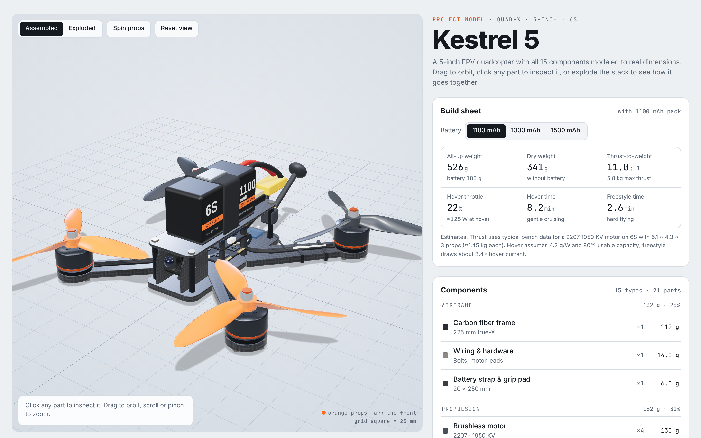
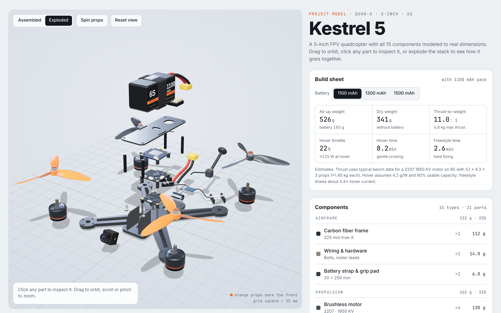

# Kestrel 5 — 5-inch FPV quadcopter model

A procedural 3D model (three.js) of a 5-inch, 6S FPV quadcopter with every component built to real dimensions, plus an interactive viewer with an exploded view and a live build sheet (weight, thrust-to-weight, flight time).

## Files

| Path | What it is |
| --- | --- |
| `index.html` | Interactive viewer and the model source. Open it in a browser (loads three.js from jsDelivr). |
| `out/kestrel5.glb` | Whole drone, one named node per part. Opens in Blender, Unity, Unreal, Godot, any glTF viewer. |
| `out/kestrel5-exploded.glb` | Same model in the exploded layout. |
| `out/components/*.glb` | Each component on its own, kept in drone coordinates so they reassemble. |
| `out/bom.csv` | Bill of materials with specs and masses. |
| `export.cjs` | Regenerates everything in `out/` (`npm install && npm run export`). |

Units are millimetres in the source and metres in the GLB files. Front is +Z, up is +Y. Every mesh carries `extras.comp` with its component id.

## Components

| Subsystem | Component | Spec | Qty | Mass |
| --- | --- | --- | --- | --- |
| Airframe | Carbon fiber frame | 225 mm true-X, 5 mm arms, 30 mm standoffs | 1 | 112 g |
| Airframe | Wiring & hardware | Ti M3 bolts, 18 AWG motor leads | 1 | 14 g |
| Airframe | Battery strap & grip pad | 20 × 250 mm | 1 | 6 g |
| Propulsion | Brushless motor | 2207, 1950 KV | 4 | 32.5 g |
| Propulsion | Propeller | 5.1 × 4.3 × 3 (orange front, smoke rear) | 4 | 4.2 g |
| Propulsion | 4-in-1 ESC | 55 A, 3–6S, 30.5 × 30.5 | 1 | 15 g |
| Flight electronics | Flight controller | F7, ICM-42688-P, 30.5 × 30.5 | 1 | 8 g |
| Flight electronics | GPS module | M10 class, 20 × 20 | 1 | 7 g |
| Flight electronics | Radio receiver | ExpressLRS 2.4 GHz | 1 | 1.5 g |
| Video & radio | FPV camera | 19 mm micro, 25° uptilt | 1 | 6.5 g |
| Video & radio | Video transmitter | 5.8 GHz, up to 1 W | 1 | 7 g |
| Video & radio | VTX antenna | 5.8 GHz RHCP, MMCX | 1 | 4 g |
| Power | LiPo battery | 6S 1100 / 1300 / 1500 mAh | 1 | 185–240 g |
| Power | Low-ESR capacitor | 1000 µF 35 V | 1 | 4 g |
| Power | Power lead | XT60, 12 AWG | 1 | 9 g |

With the 1100 mAh pack: about 526 g all-up, 11:1 thrust-to-weight, ~22% hover throttle. Performance numbers in the viewer are estimates from typical bench data, not measurements.
